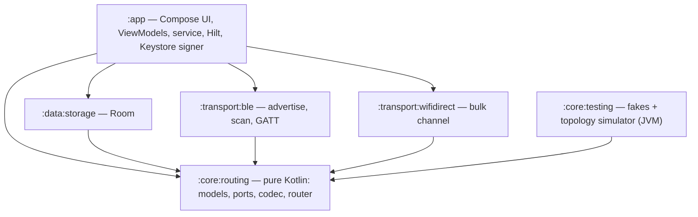

# Leylink# LeyLink — The Blackout Leyline

Delay-tolerant Bluetooth LE mesh for emergency SOS and chat. No internet, no cell network, no
infrastructure: phones in airplane mode (Bluetooth on) relay each other's messages hop by hop with
store-and-forward flooding. Built for **DroidRush 2026, Problem 07**.

* Native **Kotlin**, Jetpack Compose, Room, Hilt, coroutines.
* **`:core:routing` is pure Kotlin/JVM** (the build has no Android plugin there, so `import android.*` cannot compile).
  BLE, Wi-Fi Direct and Room are adapters behind ports.
* Pass tier: BLE discovery and chunked GATT writes, flood router with TTL-aware dedup, Room outbox, 1-hop and 2-hop SOS
  with hop telemetry, Disaster Mode.
* Victory tier: priority outbox (SOS first), reassembly, reconnect with backoff, **SOS beacon mode**, **Ed25519 signing**,
  **Wi-Fi Direct escalation** with BLE fallback, 4+ node storm test, battery tuning (scan duty cycle, idle eviction,
  digest-based "connect only if different").

> **Status honesty.** The JVM core (codec, router, simulator, all lemmas) is covered by unit tests. The Android adapters
> (BLE, Keystore signer, Wi-Fi Direct) can only be proven on real phones: fill in the [test log](#8-multi-device-physical-test-log)
> with your own evidence. Wi-Fi Direct is experimental and always falls back to BLE.

---

## 1. Architecture



Ports (all in `:core:routing`): `Transport`, `OutboxStore`, `SeenStore`, `MessageStore`, `TransactionRunner`, `Signer`,
`KeyDirectory`, `BulkChannel`, `Clock`. See `docs/ARCHITECTURE.md`.

## 2. Build and run

```bash
./gradlew :core:routing:test :core:testing:test :transport:ble:testDebugUnitTest :app:testDebugUnitTest
./gradlew :app:installDebug          # one phone at a time, or: adb -s <serial> install app/build/outputs/apk/debug/app-debug.apk
```

Requirements: Android Studio (JDK 17), at least **3 physical phones, API 26+** (the emulator has no BLE), Wi-Fi and mobile data
off on the test phones. On Android 11 and below the Location switch must be on for BLE scanning.

Install guide: install the same build on every phone → open the app → *Grant permissions* → *Start Disaster Mode* →
type a message → *Send SOS*. Optional: airplane mode on, then Bluetooth on again.

## 3. GATT profile and advertising

| Item | Value |
|---|---|
| Service UUID | `18b866bd-d745-464a-988e-a0450588f273` |
| `INBOX` (write) `…0001` | central → peripheral: HELLO frame, then chunk frames |
| `STREAM` (notify) `…0002` | peripheral → central: chunk frames |
| `INFO` (read) `…0003` | protocol version + nodeId |
| Requested MTU | 247 (usable 244); links under a 180-byte frame budget are refused |
| Advert | service UUID in the advert, manufacturer data (company id `0xFFFF`) in the scan response |

Scan-response payload (12 bytes): `version(1)=1 | nodeId(8) | flags(1) | digest(2, big-endian)`; `flags` bit 0 = **beacon**.
Tie-break: the **lower nodeId connects**, except toward a beaconing node, which is approached by whoever hears it.

## 4. Binary packet specification (v1, big-endian)

| Offset | Size | Field | Notes |
|---|---|---|---|
| 0 | 1 | version | `1` |
| 1 | 1 | type | `01` CHAT, `02` SOS, `03` ACK (reserved), `04` ANNOUNCE, `05` SYNC_SUMMARY, `06` XFER_OFFER |
| 2 | 1 | flags | bit0 SIGNED, bit1 BEACON, bit2 PUBKEY; bits 3–7 must be 0 |
| 3 | 1 | priority | `0` SOS, `1` control, `2` chat (lower is sent first) |
| 4 | 1 | ttl | 1..5, **changes in transit** |
| 5 | 1 | hop | ≥1, **changes in transit**; `ttl + hop − 1 ≤ 5` |
| 6 | 8 | msgId | random |
| 14 | 8 | originId | node that created the message |
| 22 | 8 | timestampMs | sender clock, display only |
| 30 | 2 | payloadLen | |
| 32 | n | payload | UTF-8 text for CHAT/SOS (SOS ≤ 280 chars) |
| 32+n | 32 | public key | only if PUBKEY |
| … | 64 | signature | only if SIGNED |

`decode` never throws: unknown version/type, reserved bits, bad ttl/hop, `ttl + hop − 1 > 5`, PUBKEY without SIGNED, or a
length mismatch return an error and the packet is counted and dropped.

**Signed region** = version, type, flags (with the SIGNED bit forced on), priority, msgId, originId, timestamp, payloadLen,
payload, public key. `ttl`, `hop` and the signature are excluded, so relays can lower `ttl` without breaking it.

**Chunk frame** (one GATT write): `C0 | msgId(8) | index(1) | total(1) | data` — 11-byte header, ≤169 data bytes at the 180-byte
frame budget, up to 255 chunks (≈43 KB).

**SYNC_SUMMARY payload**: `count(1) | flags(1) | count × [msgId(8) | bestTtl(1)]` — "here is what I already have".

**XFER_OFFER payload** (first byte is the sub-type, all over BLE):
`01 OFFER: msgId(8) ttl(1) size(4) sha256(32)` · `02 ACCEPT: msgId(8) info…` · `03 DECLINE: msgId(8)`.

**Digest** (advertisement): XOR of per-entry hashes over `(msgId, bestTtl)` of the dedup memory, folded to 16 bits.

## 5. TTL routing proofs

Setting: origin `o` sends message `m` with TTL `T ≤ 5`. The copy that crosses the *k*-th link carries `hop = k`,
`ttl = T − k + 1`, so **`ttl + hop = T + 1` is invariant**. Each node `v` keeps `best[v,m]`, the highest ttl it has accepted.

**Receive rule** (copy with ttl `t ≥ 1`): drop if malformed, unsigned/forged (when required) or our own; accept iff
`t > best[v,m]`; first acceptance (`NEW`) is shown to the user; every acceptance with `t ≥ 2` is queued for relay with
`ttl = t − 1, hop + 1`, never back to the neighbour it came from (split horizon).

**Lemma 1 (hop bound).** No copy is ever sent over more than `T` links. *Proof.* A node relays only if `t ≥ 2`, producing
`t − 1 ≥ 1`. Starting at `ttl = T, hop = 1` and using `ttl + hop = T + 1`, `ttl ≥ 1` forces `hop ≤ T`. The decoder also rejects
any packet with `ttl + hop − 1 > 5`, so a hostile node cannot extend the reach. ∎ (test: `ttl limits how far a message travels`)

**Lemma 2 (termination and traffic bound).** At most `2·T·|E|` transmissions per message. *Proof.* `best[v,m]` strictly
increases on every acceptance and is bounded by `T`, so `v` accepts, hence relays, at most `T` times. Each relay version is
sent at most once per neighbour (`markSent` per peer, cleared only by a strictly better version), so `v` transmits at most
`T·deg(v)` copies. Summing: `Σ T·deg(v) = 2·T·|E|`. Finite, so the flood terminates. ∎
(test: `storm - six nodes in a ring…`, asserts the bound)

**Lemma 3 (dedup must be TTL-aware).** A rule "drop every known msgId" can lose a message that is within reach. *Counter-example.*
`o → p → q → z → w1 → w2`, `T = 3`: `z` first receives the copy over the long path with `ttl = 1` and cannot relay it. Later the
link `o – z` appears and delivers `ttl = 3`. A msgId-only rule drops it and `w1`, `w2` (2 and 3 hops from `o`) never get `m`. With
`best` the late copy has `3 > 1`, so it is accepted (not shown again, because it is `IMPROVED`, not `NEW`) and relayed. The outbox
mirrors this: a higher-ttl entry replaces the stored one and clears its "sent to" markers. ∎
(tests: `a late higher-ttl copy is relayed…`, `DedupCacheTest`, `InMemorySeenStoreTest`)

**Lemma 4 (reachability within TTL).** If a path of `d ≤ T` links exists between `o` and `v` while the flood runs, `v` receives
`m`. *Proof by induction on `d`.* `d = 1`: `o` sends to every neighbour with `ttl = T`. Step: the node `u` at distance `d − 1` holds
`best ≥ T − d + 2 ≥ 2`, so it relays with `ttl ≥ T − d + 1 ≥ 1` to every neighbour except the one it learned it from; that neighbour
already has a better copy, so skipping it loses nothing. By Lemma 3 an earlier worse copy cannot block the better one. ∎
(test: `sos crosses two hops through B`)

**Lemma 5 (delay tolerance).** If an edge appears later, the message still crosses it, within retention (24 h). *Proof.* The outbox
entry is persisted (Room, one transaction with the dedup record) and survives until expiry. On a new contact the router
exchanges `SYNC_SUMMARY` and sends exactly the entries not marked as sent to that peer. A peer that missed `m` therefore
receives it on first contact, and Lemma 4 applies from there on the time-expanded graph. ∎
(test: `message waits at B until C comes into range`)

**Signing properties.** (1) *Integrity:* any change of the signed region invalidates the Ed25519 signature; verification runs
**before** dedup, so a forged copy cannot make the real message look "already seen" (test: `a packet changed after signing is
dropped before it can poison the dedup memory`). (2) *Relay safety:* `ttl`/`hop` are outside the signed region, so relayed copies
verify unchanged. (3) *Identity:* the public key travels in every signed packet and is pinned per `originId` on first use
(trust on first use); a different key for a known origin is rejected. **Not protected:** a compromised or rooted phone, an
impostor present at the very first contact, traffic analysis, and confidentiality (messages are signed, not encrypted).

## 6. Three failure modes and recovery

1. **A link dies mid-transfer** (out of range, GATT status 133, user turns Bluetooth off). Writes are serialized per link with
   timeouts; any error calls `close()` (a leaked `BluetoothGatt` would block reconnects). An outbox entry is marked sent only
   after **every** chunk was confirmed, so a half-sent message is simply sent again from chunk 0 on the next contact; the
   receiver drops partial buffers after 30 s and drops duplicates by msgId/ttl. Reconnection uses exponential backoff with
   jitter (1 s … 60 s). Nothing is lost, at worst a message is sent twice.
2. **The app or phone is killed** (battery manager, user swipe, reboot). Dedup record, history and relay entry are written in
   **one Room transaction before any acknowledgement**, so a crash leaves either all or none. The foreground service is
   restart-safe: on start the router reloads from Room and resumes flushing. *Known limit:* the in-memory "unacknowledged SOS"
   set that drives beacon mode is not persisted; a restarted phone still delivers the queued SOS on contact but does not
   re-enter beacon mode for it.
3. **The bulk channel (Wi-Fi Direct) fails or is missing.** Group formation is the least reliable step on Android. The router
   offers a large packet over BLE, waits `offerTimeoutMs`, pushes, and checks size and SHA-256. Decline, timeout, push failure
   or a missing permission all end in the same place: the packet goes out as BLE chunks (if it fits in 255 chunks) or stays queued
   without blocking the messages behind it. Tests: `when the bulk transfer fails…`, `a receiver without Wi-Fi Direct declines…`,
   `an oversized message that cannot move does not block…`.

Also handled: hostile frames (codec bounds, reassembly caps), forged/unsigned packets, TTL inflation. *Not implemented:* per-origin
rate limiting against an authenticated spammer.

## 7. Battery tuning

| Technique | Where | Effect |
|---|---|---|
| Scan duty cycle (12 s on / 18 s off, one start per 30 s, under Android's throttle) | `BleTransport.scanLoop` | largest saving; continuous while beaconing |
| Idle link eviction (120 s without traffic) | `BleTransport.idleLoop` | frees the radio; links come back on demand |
| Digest "connect only if different" | `sameDigestRecently` | skips a connection when both sides hold the same messages |
| `maxLinks = 3`, serialized GATT ops, MTU 247 | `BleConfig` | bounded radio time |
| `SYNC_SUMMARY` | router | sends only what the peer lacks |

**How to measure before/after** (log the numbers in the test log): `adb shell dumpsys batterystats --reset`, run Disaster Mode
for a fixed time (e.g. 30 min, screen off, same phones, same distance), then
`adb shell dumpsys batterystats com.leylink.app` and note estimated mAh and the Bluetooth scan time. The "before" build constructs
`BleTransport` with `BleConfig(dutyCycleEnabled = false, idleTimeoutMs = Long.MAX_VALUE, digestSkipWindowMs = 0)`.

## 8. Multi-device physical test log

Fill this in **with real results** (date, phones and Android versions, pass/fail, evidence file in `docs/evidence/`).
Steps for S0–S6 are in `docs/STAGE3_4.md`; S7–S11 in `docs/STAGE5_9.md`.

| ID | Test | Phones (model, Android) | Date | Result | Evidence |
|---|---|---|---|---|---|
| S0 | Discovery, peers in range | | | ☐ | |
| S1 | 1-hop SOS | | | ☐ | |
| S2 | 2-hop SOS via B (A and C out of range) | | | ☐ | |
| S3 | S2 in airplane mode + Bluetooth on | | | ☐ | |
| S4 | Delay tolerance (B leaves and returns) | | | ☐ | |
| S5 | SOS overtakes 20 queued chats | | | ☐ | |
| S6 | Force-stop mid-transfer, nothing lost | | | ☐ | |
| S7 | Link drop and automatic reconnect | | | ☐ | |
| S8 | Signed delivery: announces pinned, 0 rejected | | | ☐ | |
| S9 | Storm: 4+ phones sending at once | | | ☐ | |
| S10 | Wi-Fi Direct escalation or documented fallback | | | ☐ | |
| S11 | Beacon mode on and off | | | ☐ | |
| B1 | Battery before tuning (mAh / BT scan time) | | | | |
| B2 | Battery after tuning | | | | |

## 9. Tool disclosure

| Tool | Used for |
|---|---|
| Android Studio, Gradle (Kotlin DSL, version catalog, convention plugins), JDK 17, adb | build and run |
| Kotlin, kotlinx.coroutines, Jetpack Compose, Room, Hilt | app stack |
| BouncyCastle `bcprov-jdk18on` (lightweight Ed25519 API) | signatures |
| JUnit 4, kotlinx-coroutines-test | tests |
| GitHub, GitHub Actions | repo and CI |


## 10. Known limits

* Beacon state for a queued SOS is not persisted across a process restart (see failure mode 2).
* Wi-Fi Direct is experimental, needs Wi-Fi Direct hardware, the runtime permission and Location enabled on Android ≤ 12; BLE-sized
  messages never depend on it. A failed bulk transfer is retried from the start, not resumed.
* `SYNC_SUMMARY`, `XFER_OFFER` and `ACK` are neighbour-only control packets and are not signed.
* No encryption, no per-origin rate limiting, no key rotation.